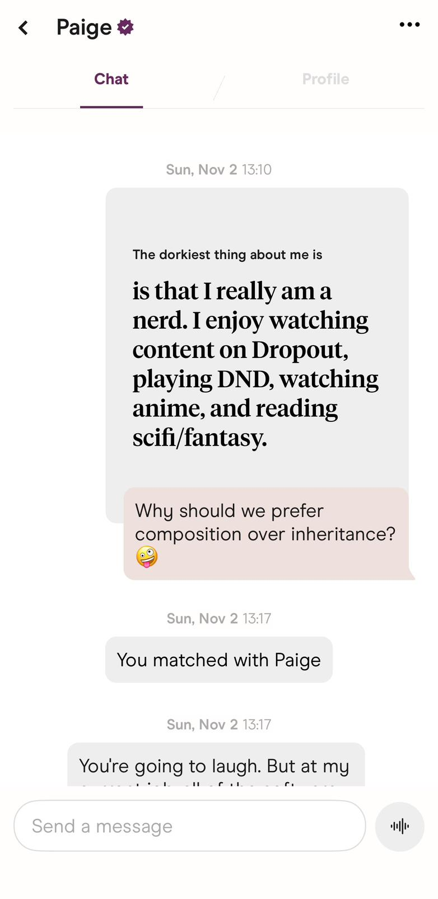

I matched with Paige on a Sunday, I didn't realize she just created her dating profile and got back to dating after a break. Her profile didn't stand out as unique or quirkly, but it was sincere and geuine. I really liked her smile and of course ~~I used the classic asking about the dog technique to get her attention and we matched.~~ I lied lol, I used the worst starting line any human could possibly think of

We had our first date two days later on a Tuesday evening. We instantly clicked and chatted for four hours. She even looked better in person, I think it was about her personality that I could only sense in person, or maybe the smile on her face.

TODO: add more in this section

I have no plan regarding where this is going, I just started this repo and I am typing random things down that are going through my mind. She is the first girl that made me feel so accepted, it's kind of unreal for me, she is perfect, she is caring and seems to know how to arose a man's desire. 

We have only been talking to each other for a couple days but oh man this feels like forever. Maybe I am thinking too fast and acting too slow, or maybe I am just dumb. I am thinking about the taste of her lip stick and the ring size of those delicate fingers. Man I am so dumb. 